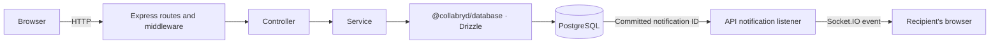

# Finding your way around Collabryd

Start with a request you recognize. When a student creates a project, the browser sends `POST /api/v1/projects`. Express finds the projects router, checks the student's access token, validates the project details and calls the controller. The service creates the project, its owner membership and its group conversation in one PostgreSQL transaction. If one write fails, PostgreSQL rolls back the transaction.



## Repository map

| Location | What lives here |
| --- | --- |
| `apps/api/` | The Express application, backend tests, and API build and test settings. |
| `apps/web/` | The React and Vite application that runs in the browser. Its integration boundary is the HTTP and Socket.IO API. |
| `packages/database/` | The PostgreSQL client, Drizzle table definitions, SQL migrations, and seed program used by the API. |
| `packages/ui/` | Shared React components. |
| `packages/eslint-config/`, `packages/typescript-config/` | Reusable lint and TypeScript settings for workspace packages. The API and database also have their own compiler settings. |
| `docs/` | The [HTTP API reference](docs/API.md) and [route-to-table map](docs/ARCHITECTURE.md). |
| `docs/dbms/` | The ER diagram, normalization notes, reference SQL and query timings. The `plans/` subfolder contains the recorded query plans. |

The root `package.json` lists commands you can run from the repository root. pnpm discovers packages through `pnpm-workspace.yaml`, and `turbo.json` defines the workspace tasks. Docker Compose starts PostgreSQL and Redis. Use `.env.example` to find configuration names. For installation and startup commands, see the [README](README.md).

## From Express route to database row

Most changes start in `apps/api/src/modules/<feature>/`. A feature's `index.ts` exports its router for the central route registry. For the project creation example, follow these files in order.

| File in `modules/projects/` | Responsibility |
| --- | --- |
| `projects.routes.ts` | Matches the HTTP method and path. Lists the middleware to run before calling the controller. |
| `projects.schemas.ts` | Defines which incoming values are valid using Zod. TypeScript types help during development. Zod also checks the actual JSON or query parameters when a request arrives. |
| `projects.controller.ts` | Reads the validated input and authenticated user from the request, calls the service, and sends the HTTP response. |
| `projects.service.ts` | Applies project rules, executes Drizzle queries and groups related writes into transactions. |

The word *schema* has two meanings here. A file under an API feature describes acceptable **request input**. A file under `packages/database/src/schema/` describes **stored data**, including columns, keys and relationships.

### Which feature owns a change?

| Module | Start here for |
| --- | --- |
| `auth` | Registration, verification email delivery and resend, login, refresh-token rotation, logout and password changes. |
| `profiles` | Student profiles, visibility, student discovery, skills, interests, preferred roles, achievements and social links. |
| `catalog` | Shared lists of skills, interests and roles used across profiles and projects. Redis can cache these reads. |
| `projects` | Project creation, discovery, status, team capacity, required skills, open roles and recommendations. |
| `applications` | Applying, withdrawing and reviewing applications. Acceptance also adds the applicant to the team and group conversation. |
| `members` | Team rosters, ownership transfers, role changes and membership removal. |
| `conversations` | Direct and project chats, messages, retry handling, read positions and unread counts. |
| `notifications` | The inbox, read state, preferences, stored notification creation and authenticated Socket.IO delivery. |
| `admin` | Platform metrics, moderation, administrative role overrides and audit entries. |

## Startup, authentication and errors

1. `apps/api/src/server.ts` imports the Express app, creates an HTTP server, attaches Socket.IO, then listens on `BACKEND_PORT`. It also handles shutdown. Tests can import `app.ts` directly.
2. `app.ts` installs the request ID, security headers, CORS, body parsing, logging and rate limiting. It mounts the root API router at `/api`. The `config/` folder contains environment validation, logging and the optional Redis connection.
3. `routes/index.ts` mounts health checks and API v1. Look in `routes/v1.routes.ts` for the first part of a feature's URL. For example, `/projects/:projectId/applications` mounts the **applications** router.
4. On protected routes, `common/middleware/auth.middleware.ts` verifies the Bearer access token and loads the current account from PostgreSQL. Additional middleware and service checks enforce admin, project, conversation and visibility rules.
5. The controller sends the result using `common/utils/response.ts`. The central error middleware maps validation, application and database errors to HTTP responses. `common/types/express.d.ts` tells TypeScript about fields middleware adds to a request, such as `req.user`.

## Where PostgreSQL fits

The API imports `db` and table definitions from the workspace package `@collabryd/database`. Its `src/client.ts` creates a pool of reusable PostgreSQL connections and gives that pool to Drizzle. The API runtime and Drizzle Kit both use `src/database-url.ts` to resolve the address. A configured `DATABASE_URL` takes priority over the separate host, port, database and credential settings.

- **Table definitions** are in `packages/database/src/schema/`, grouped by subject. Start with `projects.ts` for projects, applications and memberships or `messaging.ts` for conversations and messages. `relations.ts` describes how records connect across tables.
- **Migrations** are the ordered SQL files under `packages/database/drizzle/`. Run `pnpm db:migrate` to apply pending files. The runner in `src/migrate.ts` records filenames and checksums. An already-applied file must keep its contents.
- **Seed data** comes from `src/seed.ts`. Running `pnpm db:seed` populates the catalog. In development it also creates sample users and a project.
- **Production imports** resolve to JavaScript under `packages/database/dist/`. TypeScript reads the source types. A relative import ending in `.js` inside a TypeScript file names the file Node will load after compilation. Run `pnpm backend:build` to compile the database package and API together.

## Connecting the frontend

The default local API origin is `http://localhost:3000`. Set `CORS_ORIGIN` on the API to allow the browser application's origin. Browse `/api/v1/docs` for route discovery and use `/api/v1/docs/openapi.json` for the machine-readable listing.

For example, after login, read `data.tokens.accessToken` from the response. Fetch the signed-in student's profile using the access token.

```js
const response = await fetch("http://localhost:3000/api/v1/profiles/me", {
  headers: { Authorization: `Bearer ${accessToken}` },
});
const body = await response.json();
if (!response.ok) throw new Error(body.error.message);
const profile = body.data;
```

When refreshing a session, replace both stored tokens with the pair returned by `POST /api/v1/auth/refresh`. Reusing an old refresh token revokes sessions. For live notifications, connect a Socket.IO client to the **API origin**, pass `auth: { token: accessToken }`, and listen for `notification:new`. Reload the REST inbox on reconnect and merge records by `notificationId`. The verification page and notification payload are described in the [API reference](docs/API.md).

## Debugging a request

| Symptom | First place to look |
| --- | --- |
| A URL returns 404 | Combine the mount path in `routes/v1.routes.ts` with the method and path in the feature's routes file. |
| Valid-looking JSON returns 400 | Check the feature's Zod schema and the response's error details. Body, query and path parameters are validated separately. |
| A request returns 401 or 403 | Check the Bearer token and account status for authentication, then inspect the route guard and service for role, membership or visibility requirements. |
| The API starts but queries fail | Request `/api/health/ready` to check PostgreSQL connectivity. If the connection works, check the target database's migrations and trace the Drizzle query in the service. |
| A notification appears after a reload only | Check the socket handshake token, the listener in `notifications.socket.ts` and migration `0002_live_notifications.sql`. If the inbox is also empty, check the in-app preference and the dispatcher. |

For a working example of a multi-step request, read `apps/api/tests/integration/collabryd.e2e.test.ts`. It exercises authentication, projects, membership, messaging and sockets with PostgreSQL. Point `DATABASE_URL` at a disposable database before running `pnpm backend:test`. Smaller examples of validation, token handling and HTTP errors live in `apps/api/tests/unit/core.test.ts`.
