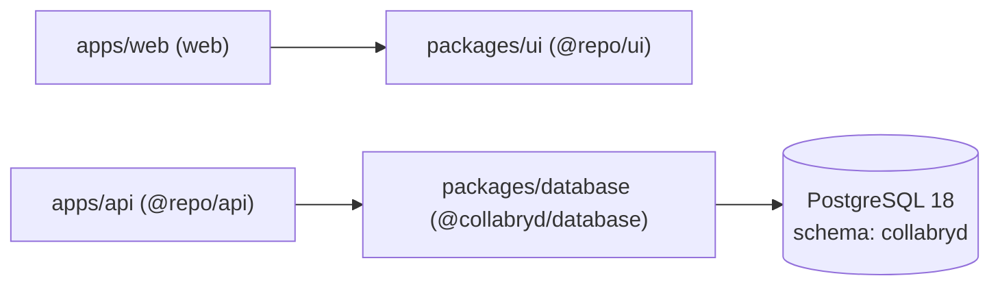

# Collabryd — Architecture & Codebase Mapping

This document is the canonical map of the Collabryd monorepo, connecting **HTTP routes**, **backend domain modules**, **Drizzle ORM schema files**, **PostgreSQL `collabryd` tables**, and the **authoritative DBMS specification** in `docs/dbms/`.

---

## 1. Monorepo Directory Structure

```text
Collabryd/
├── apps/
│   ├── api/                                  # @repo/api — Express 5 + TypeScript REST API
│   │   ├── src/
│   │   │   ├── server.ts                     # HTTP bootstrap & graceful SIGINT/SIGTERM shutdown
│   │   │   ├── app.ts                        # Express middleware composition (helmet, cors, pino, rate-limit)
│   │   │   ├── config/
│   │   │   │   ├── env.ts                    # Zod-validated environment configuration
│   │   │   │   ├── logger.ts                 # Pino structured logger with credential redaction
│   │   │   │   ├── redis.ts                  # Optional Redis 8 client with graceful fallback
│   │   │   │   └── index.ts                  # Config barrel export
│   │   │   ├── common/
│   │   │   │   ├── cache/cache.service.ts    # Read-through Redis JSON cache & prefix invalidation
│   │   │   │   ├── errors/app-error.ts       # Typed AppError hierarchy & PostgreSQL error mapper
│   │   │   │   ├── middleware/
│   │   │   │   │   ├── auth.middleware.ts    # requireAuth, optionalAuth, requireAdmin
│   │   │   │   │   ├── error.middleware.ts   # notFoundHandler & centralized errorHandler
│   │   │   │   │   ├── rate-limit.middleware.ts
│   │   │   │   │   └── validate.middleware.ts # Express 5-safe Zod validator + typed getters
│   │   │   │   ├── types/express.d.ts        # Request.user & Request.validated augmentation
│   │   │   │   ├── utils/
│   │   │   │   │   ├── crypto.ts             # Argon2id hashing, SHA-256, CSPRNG tokens
│   │   │   │   │   ├── jwt.ts                # Access & refresh JWT sign/verify + duration parser
│   │   │   │   │   ├── pagination.ts         # Shared pagination Zod schema & metadata builder
│   │   │   │   │   ├── response.ts           # Standardized JSON response helpers
│   │   │   │   │   └── visibility.ts         # Shared PUBLIC / CAMPUS_ONLY / PRIVATE predicates
│   │   │   │   └── index.ts                  # Common barrel export
│   │   │   ├── routes/
│   │   │   │   ├── index.ts                  # Mounts /health & /v1 under /api
│   │   │   │   ├── health.routes.ts          # /api/health & /api/health/ready
│   │   │   │   └── v1.routes.ts              # Central /api/v1/* route-to-module registry
│   │   │   ├── docs/
│   │   │   │   └── openapi.ts                # OpenAPI 3.1 JSON specification
│   │   │   └── modules/                      # Domain-isolated vertical slices
│   │   │       ├── auth/                     # auth.{schemas,service,controller,routes}.ts
│   │   │       ├── catalog/                  # catalog.{schemas,service,controller,routes}.ts
│   │   │       ├── profiles/                 # profiles.{schemas,service,controller,routes}.ts
│   │   │       ├── projects/                 # projects.{schemas,service,controller,routes}.ts
│   │   │       ├── applications/             # applications.{schemas,service,controller,routes}.ts
│   │   │       ├── members/                  # members.{schemas,service,controller,routes}.ts
│   │   │       ├── conversations/            # conversations.{schemas,service,controller,routes}.ts
│   │   │       ├── notifications/            # REST inbox, dispatcher and Socket.IO listener
│   │   │       └── admin/                    # admin.{schemas,service,controller,routes}.ts
│   │   ├── tests/
│   │   │   ├── unit/core.test.ts             # Unit & HTTP transport tests (Vitest + Supertest)
│   │   │   └── integration/collabryd.e2e.test.ts # Full PostgreSQL 18 end-to-end suite
│   │   ├── tsconfig.json
│   │   └── vitest.config.ts
│   └── web/                                  # React 19 + Vite 8 frontend
├── packages/
│   ├── database/                             # @collabryd/database — Drizzle ORM & migrations
│   │   ├── drizzle/
│   │   │   ├── 0000_collabryd_schema.sql     # Verbatim docs/dbms/03_schema.sql (23 tables)
│   │   │   ├── 0001_backend_extensions.sql   # Additive RBAC role, DM check & query-plan indexes
│   │   │   └── 0002_live_notifications.sql   # Signal committed notification inserts
│   │   ├── src/
│   │   │   ├── database-url.ts               # Shared runtime and Drizzle Kit connection settings
│   │   │   ├── client.ts                     # pg.Pool + Drizzle instance + closePool()
│   │   │   ├── migrate.ts                    # Checksum-verified SQL migration runner
│   │   │   ├── seed.ts                       # Idempotent campus seed data
│   │   │   ├── index.ts                      # Package public entrypoint
│   │   │   └── schema/
│   │   │       ├── constants.ts              # collabryd pgSchema & domain enum types
│   │   │       ├── auth.ts                   # users, email_verification_tokens, refresh_sessions
│   │   │       ├── profiles.ts               # user_profiles, achievements, social_links
│   │   │       ├── catalog.ts                # skills, interests, roles, user_* bridges
│   │   │       ├── projects.ts               # projects, project_skills, project_roles, applications, project_members
│   │   │       ├── messaging.ts              # conversations, conversation_members, messages
│   │   │       ├── notifications.ts          # notifications, notification_preferences
│   │   │       ├── admin.ts                  # admin_audit_logs
│   │   │       ├── relations.ts              # Drizzle relations across all 23 tables
│   │   │       └── index.ts                  # Schema barrel export
│   │   ├── drizzle.config.ts
│   │   └── tsconfig.json
│   ├── ui/                                   # @repo/ui — Shared React components
│   ├── eslint-config/                        # @repo/eslint-config
│   └── typescript-config/                    # @repo/typescript-config
├── docs/
│   ├── ARCHITECTURE.md                       # This architecture & mapping reference
│   ├── BACKEND_ARCHITECTURE.md               # Deep-dive backend system & module architecture
│   ├── API.md                                # REST API endpoint contract
│   └── dbms/                                 # Authoritative DBMS docs, ER diagram, SQL & EXPLAIN plans
├── docker-compose.yml                        # PostgreSQL 18 (5434) + Redis 8 (6379)
├── .env.example                              # Environment template
├── package.json                              # Workspace root scripts
├── pnpm-workspace.yaml                       # pnpm workspace & native build allowlist
└── turbo.json                                # Turborepo pipeline (build, lint, check-types, test, dev)
```

---

## 2. Package Exports & Dependency Map



| Package | Workspace Name | Public Exports |
|---|---|---|
| `packages/database` | `@collabryd/database` | `.` (`db`, `pool`, `closePool`, all tables), `./schema`, `./migrate`, `./seed` |
| `apps/api` | `@repo/api` | REST API server (`src/server.ts`) and Express app factory (`src/app.ts`) |
| `apps/web` | `web` | Vite + React frontend SPA |
| `packages/ui` | `@repo/ui` | Shared React UI components |

---

## 3. Route → Module → Database Table Mapping

| HTTP Prefix (`apps/api/src/routes/v1.routes.ts`) | Module Folder | Primary Tables (`collabryd.*`) | Key Transactional Guarantees |
|---|---|---|---|
| `/api/health`, `/api/health/ready` | `routes/health.routes.ts` | — | Live `SELECT 1` DB readiness probe |
| `/api/v1/docs/openapi.json` | `docs/openapi.ts` | — | OpenAPI 3.1 contract |
| `/api/v1/auth` | `modules/auth/` | `users`, `user_profiles`, `notification_preferences`, `email_verification_tokens`, `refresh_sessions` | Atomic register; `FOR UPDATE` email verify; refresh token rotation + replay revokes all sessions |
| `/api/v1/catalog` | `modules/catalog/` | `skills`, `interests`, `roles`, `user_skills`, `user_interests`, `project_roles` | Aggregated catalog usage/opening counts |
| `/api/v1/profiles`, `/api/v1/students` | `modules/profiles/` | `user_profiles`, `user_skills`, `user_interests`, `user_preferred_roles`, `achievements`, `social_links` | `PUBLIC` / `CAMPUS_ONLY` / `PRIVATE` visibility filtering; atomic list replacements |
| `/api/v1/projects`, `/api/v1/recommendations` | `modules/projects/` | `projects`, `project_skills`, `project_roles`, `project_members`, `conversations`, `conversation_members` | Atomic project + `OWNER` member + `GROUP` conversation creation; status-change fan-out notifications |
| `/api/v1/projects/:projectId/applications`, `/api/v1/applications` | `modules/applications/` | `applications`, `projects`, `project_members`, `conversations`, `conversation_members`, `notifications` | Partial unique index `uq_active_application`; `FOR UPDATE` capacity-safe accept + auto-join team & group chat |
| `/api/v1/projects/:projectId/members` | `modules/members/` | `project_members`, `projects`, `conversations`, `conversation_members`, `notifications` | Atomic ownership transfer; synchronized removal from `project_members` & group conversation |
| `/api/v1/conversations` | `modules/conversations/` | `conversations`, `conversation_members`, `messages`, `notifications` | Advisory-locked DM dedup; `FOR UPDATE` monotonic `sequence_number` + `client_message_id` idempotency |
| `/api/v1/notifications` | `modules/notifications/` | `notifications`, `notification_preferences` | Preference-aware dispatch (`inapp_notifications`); batch mark-read |
| `/api/v1/admin` | `modules/admin/` | `admin_audit_logs`, `users`, `refresh_sessions`, `projects`, `project_members` | RBAC (`system_role = 'ADMIN'`); session revocation on suspend; mandatory audit log entries |

---

## 4. Drizzle Schema File → PostgreSQL Table Mapping (All 23 Tables)

| Drizzle File (`packages/database/src/schema/`) | PostgreSQL Tables (`collabryd.*`) | Count |
|---|---|---:|
| `auth.ts` | `users`, `email_verification_tokens`, `refresh_sessions` | 3 |
| `profiles.ts` | `user_profiles`, `achievements`, `social_links` | 3 |
| `catalog.ts` | `skills`, `interests`, `roles`, `user_skills`, `user_interests`, `user_preferred_roles` | 6 |
| `projects.ts` | `projects`, `project_skills`, `project_roles`, `applications`, `project_members` | 5 |
| `messaging.ts` | `conversations`, `conversation_members`, `messages` | 3 |
| `notifications.ts` | `notifications`, `notification_preferences` | 2 |
| `admin.ts` | `admin_audit_logs` | 1 |
| **Total** | **All BCNF tables from `docs/dbms/03_schema.sql`** | **23** |

---

## 5. DBMS Query Workload (`docs/dbms/04_queries.sql`) → Backend Mapping

| Query ID | Purpose | Backend Service Function | Endpoint |
|---|---|---|---|
| `R01` | Case-insensitive login lookup | `auth.service.ts → loginStudent` | `POST /api/v1/auth/login` |
| `R02`–`R05` | Full self profile, skills, interests, roles, achievements, social links | `profiles.service.ts → getOwnFullProfile` | `GET /api/v1/profiles/me` |
| `R06` | Visibility-checked student profile | `profiles.service.ts → getStudentProfileById` | `GET /api/v1/students/:userId` |
| `R07`–`R09` | Skills, interests, roles catalogs with counts | `catalog.service.ts → listSkills / listInterests / listRoles` | `GET /api/v1/catalog/{skills,interests,roles}` |
| `R10`–`R11` | Project discovery by category/type/skill | `projects.service.ts → listProjects` | `GET /api/v1/projects` |
| `R12`–`R14` | Project detail, team roster, open roles | `projects.service.ts → getProjectById`, `members.service.ts → listProjectMembers` | `GET /api/v1/projects/:projectId`, `GET /api/v1/projects/:projectId/members` |
| `R15` | Candidate recommendations for project | `projects.service.ts → recommendCandidatesForProject` | `GET /api/v1/projects/:projectId/recommendations` |
| `R16` | Project recommendations for student | `projects.service.ts → recommendProjectsForStudent` | `GET /api/v1/recommendations/projects` |
| `R17` | Owner/admin incoming pending applications | `applications.service.ts → listIncomingApplications` | `GET /api/v1/applications/incoming` |
| `R18` | Student submitted applications tracker | `applications.service.ts → listMyApplications` | `GET /api/v1/applications/me` |
| `R19` | Project team capacity check | `projects.service.ts → getProjectCapacity` | `GET /api/v1/projects/:projectId/capacity` |
| `R20` | Conversation inbox with unread counts | `conversations.service.ts → listUserConversations` | `GET /api/v1/conversations` |
| `R21` | Direct conversation lookup/creation | `conversations.service.ts → createOrGetDirectConversation` | `POST /api/v1/conversations/direct` |
| `R22` | Cursor-paginated conversation messages | `conversations.service.ts → listConversationMessages` | `GET /api/v1/conversations/:conversationId/messages` |
| `R23` | Unread in-app notifications | `notifications.service.ts → listNotifications` | `GET /api/v1/notifications?unreadOnly=true` |
| `R24` | Admin operational platform metrics | `admin.service.ts → getPlatformMetrics` | `GET /api/v1/admin/metrics` |
| `R25` | Admin audit log report | `admin.service.ts → listAuditLogs` | `GET /api/v1/admin/audit-logs` |
| `W01`–`W03` | Register, token creation, email verification | `auth.service.ts → registerStudent / verifyEmail` | `POST /api/v1/auth/{register,verify-email}` |
| `W04`–`W05` | Upsert profile & student skills | `profiles.service.ts → upsertOwnProfile / upsertUserSkill` | `PUT /api/v1/profiles/me`, `POST /api/v1/profiles/me/skills` |
| `W06` | Create project with owner | `projects.service.ts → createProject` | `POST /api/v1/projects` |
| `W07`–`W08` | Submit & accept application | `applications.service.ts → submitApplication / acceptApplication` | `POST /api/v1/projects/:projectId/applications`, `POST /api/v1/applications/:applicationId/accept` |
| `W09` | Send sequenced idempotent message | `conversations.service.ts → sendMessage` | `POST /api/v1/conversations/:conversationId/messages` |
| `W10` | Mark all notifications read | `notifications.service.ts → markAllNotificationsRead` | `PATCH /api/v1/notifications/read-all` |
