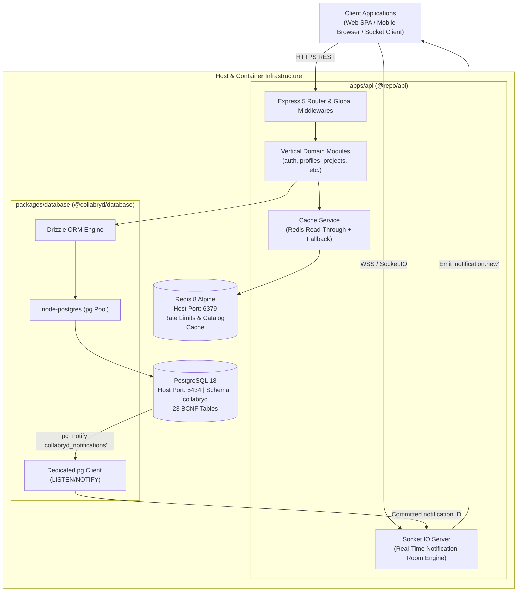
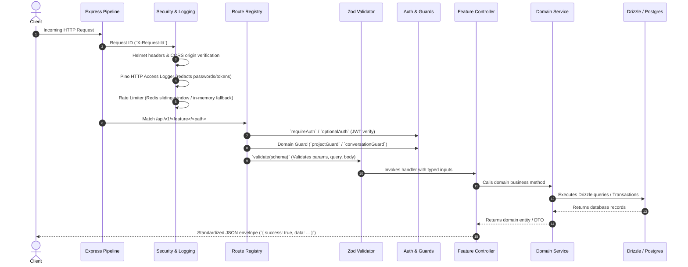
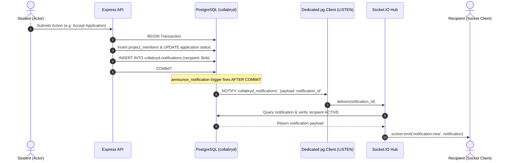

# Collabryd — Backend Architecture Specification

This document provides a comprehensive technical breakdown of the **Collabryd backend architecture** (`apps/api` and `packages/database`). It covers system topology, request lifecycles, modular domain slices, security invariants, data modeling, concurrency control, and real-time delivery mechanics.

---

## 1. System Topology & High-Level Architecture

Collabryd follows a **modular monolith** design pattern organized in a Turborepo monorepo with strict package boundaries.



### Technology Matrix
- **Runtime:** Node.js `>= 24.0.0` (ESM native)
- **Language:** TypeScript 7
- **HTTP Engine:** Express 5.2.1
- **Real-Time Push:** Socket.IO 4.8.x + PostgreSQL `LISTEN`/`NOTIFY`
- **Primary Database:** PostgreSQL 18 on mapped host port **`5434`**
- **ORM & Data Layer:** Drizzle ORM 0.45.x + `pg` (node-postgres connection pool)
- **Cache & Rate-Limiting:** Redis 8 Alpine (port **`6379`**) with in-memory degradation fallback
- **Authentication & Security:** Argon2id password hashing, rotating JWT refresh tokens, Helmet, CORS, and Zod input validation

---

## 2. Directory & Module Organization

The backend is strictly divided into **shared infrastructure** and **vertical domain modules**:

```text
apps/api/src/
├── server.ts                    # HTTP bootstrap, graceful shutdown, socket binding
├── app.ts                       # Middleware composition, rate limiting, route mounting
├── config/                      # Environment variables, Pino logger, Redis connection
│   ├── env.ts                   # Strict Zod-validated environment config
│   ├── logger.ts                # Pino logger with redaction rules
│   ├── redis.ts                 # Redis singleton with connection fallback
│   └── index.ts
├── common/                      # Reusable, domain-agnostic backend primitives
│   ├── cache/                   # Redis read-through cache & prefix invalidator
│   ├── errors/                  # AppError hierarchy & PostgreSQL error code mapper
│   ├── middleware/              # Auth, error handling, rate-limit, validation guards
│   ├── types/                   # Express request & user type augmentations
│   └── utils/                   # Argon2id crypto, JWT token signing, pagination, visibility
├── routes/                      # Route composition and aggregation
│   ├── health.routes.ts         # /api/health and /api/health/ready
│   ├── v1.routes.ts             # Central /api/v1 router registry
│   └── index.ts
├── docs/                        # OpenAPI 3.1 specification & interactive UI
└── modules/                     # Vertical domain slices (self-contained)
    ├── admin/                   # Campus admin moderation, user suspension, audit logs
    ├── applications/            # Project join applications, approvals, capacity checks
    ├── auth/                    # Registration, verification emails, login, session rotation
    ├── catalog/                 # System-wide skills, interests, and roles taxonomy
    ├── conversations/           # 1-on-1 direct messages & team chat channels
    ├── members/                 # Team rosters, permissions, role updates, member departures
    ├── notifications/           # In-app notification inbox, dispatcher & Socket.IO listener
    ├── profiles/                # Student discovery, resumes, achievements, social links
    └── projects/                # Project lifecycle, team requirements, recommendation engine
```

---

## 3. Request Lifecycle & Middleware Pipeline

Every HTTP request traverses an ordered pipeline designed for zero-trust boundary verification:



### Middleware Responsibilities
1. **Request Tracking (`request-id.middleware.ts`):** Assigns a unique UUID to every incoming request via `X-Request-Id` for distributed trace correlation.
2. **Access Logging (`logger.ts`):** Pino logs method, URL, status code, and latency. Automatically redacts `authorization`, `password`, `refreshToken`, and sensitive tokens.
3. **Rate Limiting (`rate-limit.middleware.ts`):** Enforces request quotas (e.g., auth registration and login are aggressively rate-limited). Backed by Redis when available; degrades to local memory without throwing.
4. **Validation (`validate.middleware.ts`):** Validates path parameters, query parameters, and request body using Zod schemas. Strips unknown parameters and parses types before reaching controllers.
5. **Centralized Error Handling (`error.middleware.ts`):** Intercepts uncaught exceptions and `AppError` instances. Maps PostgreSQL error codes (e.g., `23505` unique violation $\to$ `409 Conflict`, `23503` foreign key violation $\to$ `404/400`) to user-safe error responses without leaking stack traces in production.

---

## 4. Authentication, Security & Session Management

```mermaid
flowchart TD
    subgraph Registration ["Registration & Verification"]
        Reg["POST /api/v1/auth/register"] --> Hash["Hash password with Argon2id"]
        Hash --> InsertUser["Insert user (ACTIVE/UNVERIFIED)"]
        InsertUser --> GenToken["Generate CSPRNG Verification Token"]
        GenToken --> StoreHash["Store SHA-256 Token Hash in DB"]
        StoreHash --> SendMail["Send verification email / logger output"]
    end

    subgraph LoginFlow ["Authentication & Tokens"]
        Login["POST /api/v1/auth/login"] --> VerifyArgon["Verify Argon2id password"]
        VerifyArgon --> CheckStatus["Check ACTIVE & campus match"]
        CheckStatus --> IssueTokens["Issue Access JWT (15m) & Refresh JWT (7d)"]
        IssueTokens --> StoreSession["Insert refresh_sessions record with family UUID"]
    end

    subgraph RotationFlow ["Token Rotation & Replay Protection"]
        Refresh["POST /api/v1/auth/refresh"] --> CheckReuse{"Token already used?"}
        CheckReuse -->|Yes - Replay Attack!| RevokeAll["REVOKE ALL SESSIONS IN FAMILY\nForce re-login on all devices"]
        CheckReuse -->|No - Valid| Rotate["Invalidate current token\nIssue new Access + Refresh JWT"]
    end
```



### Security Guarantees
1. **Argon2id Hashing:** All user passwords are encrypted using memory-hard Argon2id parameters before storage.
2. **Short-Lived Access Tokens:** Signed with HMAC-SHA256 (`JWT_ACCESS_SECRET`) with a default lifespan of 15 minutes.
3. **Rotating Refresh Sessions:**
   - Every refresh operation issues a brand new refresh token and marks the previous token as replaced.
   - If a used token is submitted again (indicating token theft), the backend revokes the entire session family, locking out the attacker.
4. **Campus Domain Protection:** Can restrict registration to approved campus email domains via the `ALLOWED_EMAIL_DOMAINS` environment variable (e.g., `@campus.edu`).

---

## 5. Domain Modules Deep Dive

### 1. Auth Module (`src/modules/auth`)
- **Key Operations:** Student registration, email verification, login, token refresh, password resets, and session revoking.
- **Invariants:**
  - Email addresses are normalized (`toLowerCase()`).
  - Account status lifecycle: `PENDING_VERIFICATION` $\to$ `ACTIVE` $\to$ `SUSPENDED`.
  - Refresh tokens are hashed using SHA-256 before database persistence.

### 2. Profiles Module (`src/modules/profiles`)
- **Key Operations:** Student discovery, profile management, achievements, social links, and skills association.
- **Privacy Enforcement (`common/utils/visibility.ts`):**
  - `PUBLIC`: Accessible to any authenticated user.
  - `CAMPUS_ONLY`: Visible only to students from the same verified institution.
  - `PRIVATE`: Visible strictly to the profile owner and platform administrators.

### 3. Projects Module (`src/modules/projects`)
- **Key Operations:** Project creation, editing, status lifecycle, capacity enforcement, and search recommendations.
- **Project Status Lifecycle:** `DRAFT` $\to$ `RECRUITING` $\to$ `ACTIVE` $\to$ `COMPLETED` / `ARCHIVED`.
- **Atomic Creation:** When a project is created, the service atomically writes:
  1. The project record (`collabryd.projects`).
  2. The creator as `OWNER` in `collabryd.project_members`.
  3. A corresponding `GROUP` conversation channel in `collabryd.conversations`.
  4. The creator into `collabryd.conversation_members`.
- **Recommendation Engine (Queries R15 & R16):** Matches students to projects and projects to students based on overlapping required skills, preferred roles, and availability status.

### 4. Applications Module (`src/modules/applications`)
- **Key Operations:** Applying to open roles, withdrawing, rejecting, and accepting candidates.
- **Concurrency & Invariants:**
  - Prevent duplicate pending applications via partial unique index `uq_active_application`.
  - Transactional Capacity Lock: Accepting an applicant executes `SELECT ... FOR UPDATE` on the project record to lock the row, verify `currentMembers < maxTeamSize`, and atomically insert the student into `project_members` and the project group chat.

### 5. Members Module (`src/modules/members`)
- **Key Operations:** Role updates (`CO_LEADER`, `MEMBER`), ownership transfers, voluntary departures, and evictions.
- **Invariants:**
  - Every project must maintain exactly one `OWNER`.
  - Removing a member simultaneously revokes their access to the project's internal group chat.

### 6. Conversations & Messaging Module (`src/modules/conversations`)
- **Key Operations:** Direct 1-to-1 chats and Project group channels.
- **Advisory Lock Deduplication:** Uses PostgreSQL transaction-level advisory locks based on sorted user IDs (`hashtext(least(u1, u2))`) to prevent duplicate direct conversation creation under concurrent requests.
- **Sequenced Messages:** Every message receives a monotonic, gap-free `sequence_number` per conversation generated via `SELECT MAX(sequence_number) ... FOR UPDATE`.
- **Client Idempotency:** Accepts a `clientMessageId` to prevent duplicate message posting on network retries.

### 7. Notifications Module (`src/modules/notifications`)
- **Key Operations:** In-app inbox, read state management, and real-time delivery.
- **Preferences:** Respects student `inapp_notifications` preferences prior to dispatch.
- **Batch Operations:** Allows marking single notifications or all unread notifications read in a single query.

### 8. Catalog Module (`src/modules/catalog`)
- **Key Operations:** Global lookup of skills, interests, and project roles.
- **Read-Through Caching:** Cached in Redis with a 1-hour TTL. Automatically invalidated when administrators modify taxonomy entries.

### 9. Admin Module (`src/modules/admin`)
- **Key Operations:** Student suspension, account reactivation, project moderation, and platform metrics.
- **RBAC:** Secured with `requireAdmin` middleware (`system_role = 'ADMIN'`).
- **Audit Logs:** Mandatory logging of administrative actions into `collabryd.admin_audit_logs`.

---

## 6. Database Architecture (`packages/database`)

The persistence tier consists of **23 BCNF-normalized tables** residing inside the `collabryd` PostgreSQL schema.

```mermaid
erDiagram
    USERS ||--o{ REFRESH_SESSIONS : maintains
    USERS ||--o| USER_PROFILES : has
    USERS ||--o{ EMAIL_VERIFICATION_TOKENS : receives
    USERS ||--o{ NOTIFICATIONS : receives
    USERS ||--o| NOTIFICATION_PREFERENCES : configures
    USERS ||--o{ USER_SKILLS : possesses
    USERS ||--o{ USER_INTERESTS : interested_in
    USERS ||--o{ USER_PREFERRED_ROLES : prefers
    USERS ||--o{ ACHIEVEMENTS : earns
    USERS ||--o{ SOCIAL_LINKS : links

    PROJECTS ||--o{ PROJECT_SKILLS : requires
    PROJECTS ||--o{ PROJECT_ROLES : seeks
    PROJECTS ||--o{ PROJECT_MEMBERS : includes
    PROJECTS ||--o{ APPLICATIONS : receives
    USERS ||--o{ PROJECT_MEMBERS : joins
    USERS ||--o{ APPLICATIONS : submits

    CONVERSATIONS ||--o{ CONVERSATION_MEMBERS : includes
    CONVERSATIONS ||--o{ MESSAGES : contains
    USERS ||--o{ CONVERSATION_MEMBERS : participates
    USERS ||--o{ MESSAGES : sends

    SKILLS ||--o{ USER_SKILLS : cataloged
    SKILLS ||--o{ PROJECT_SKILLS : cataloged
    INTERESTS ||--o{ USER_INTERESTS : cataloged
    ROLES ||--o{ PROJECT_ROLES : cataloged
    ROLES ||--o{ USER_PREFERRED_ROLES : cataloged

    USERS ||--o{ ADMIN_AUDIT_LOGS : targets
```



### Schema Summary Table

| Domain | Table Name | Purpose |
|---|---|---|
| **Auth** | `collabryd.users` | Core user identity, email, password hash, status, campus |
| | `collabryd.email_verification_tokens` | Secure email verification tokens (SHA-256 hashed) |
| | `collabryd.refresh_sessions` | Active refresh tokens with session family tracking |
| **Profiles** | `collabryd.user_profiles` | Student bios, campus, major, year, visibility settings |
| | `collabryd.achievements` | Hackathon wins, awards, and certifications |
| | `collabryd.social_links` | Portfolio, GitHub, and LinkedIn links |
| **Catalog** | `collabryd.skills` | System skills taxonomy |
| | `collabryd.interests` | Student interest tags |
| | `collabryd.roles` | Functional team roles (e.g. Frontend, ML Engineer) |
| | `collabryd.user_skills` | Bridge table connecting users to skills |
| | `collabryd.user_interests` | Bridge table connecting users to interests |
| | `collabryd.user_preferred_roles`| Bridge table connecting users to preferred roles |
| **Projects** | `collabryd.projects` | Project listings, descriptions, team size limits |
| | `collabryd.project_skills` | Required skills per project |
| | `collabryd.project_roles` | Open roles per project |
| | `collabryd.project_members` | Team member roster with roles (`OWNER`, `MEMBER`) |
| | `collabryd.applications` | Role applications with status (`PENDING`, `ACCEPTED`, etc.) |
| **Messaging** | `collabryd.conversations` | Conversation metadata (1-on-1 `DIRECT` or `GROUP`) |
| | `collabryd.conversation_members` | Participants in each conversation |
| | `collabryd.messages` | Sequenced, immutable messages |
| **Notifications** | `collabryd.notifications` | In-app alerts and notifications |
| | `collabryd.notification_preferences` | User notification channel preferences |
| **Admin** | `collabryd.admin_audit_logs` | Immutable audit trail of moderation & admin events |

### Migration Strategy
- Migrations live in `packages/database/drizzle/`.
- Managed by `packages/database/src/migrate.ts` using PostgreSQL advisory locks (`pg_advisory_lock(84729104)`).
- Guarantees zero race conditions during parallel container startups.

---

## 7. Real-Time Notification Pipeline

Collabryd implements an **asynchronous committed-state event notification pipeline**:



### Why this design?
- **Zero Ghost Notifications:** Notifications are triggered by PostgreSQL `AFTER INSERT` *after* the transaction is committed. If a transaction rolls back due to a conflict, no notification is ever emitted.
- **Loose Coupling:** The HTTP API handler does not directly depend on open WebSocket connections to complete its write transaction.

---

## 8. Caching & Redis Integration

- **Strategy:** Read-through caching with proactive write invalidation.
- **Use Cases:**
  1. System catalogs (`/api/v1/catalog/*`).
  2. Rate-limiting counters (`express-rate-limit` using `rate-limit-redis`).
- **Resilience:** If Redis is down or unconfigured (`REDIS_URL` omitted), the backend automatically falls back to in-memory rate limiting and direct database reads without throwing errors.

---

## 9. Testing & Quality Verification

| Test Type | Runner / Tool | Focus | Location |
|---|---|---|---|
| **Unit Tests** | Vitest | Crypto, JWT, Zod schemas, AppError mapping, pagination | `apps/api/tests/unit/core.test.ts` |
| **HTTP Transport** | Supertest | Status codes, error payloads, OpenAPI endpoints | `apps/api/tests/unit/core.test.ts` |
| **Integration Suite** | Vitest + PostgreSQL 18 | Full E2E user lifecycle, transactions, capacity, messaging | `apps/api/tests/integration/collabryd.e2e.test.ts` |
| **Type Checking** | TypeScript (`tsc --noEmit`) | Monorepo-wide static typing | `pnpm check-types` |
| **Code Quality** | ESLint | Code style & linting across all packages | `pnpm lint` |

---

## 10. Operational Runbook

```bash
# 1. Start local PostgreSQL & Redis
docker compose up -d

# 2. Run migrations
pnpm db:migrate

# 3. Seed demo accounts and catalog data
pnpm db:seed

# 4. Start backend in development mode
pnpm backend:dev

# 5. Execute test suites
pnpm backend:test
```
