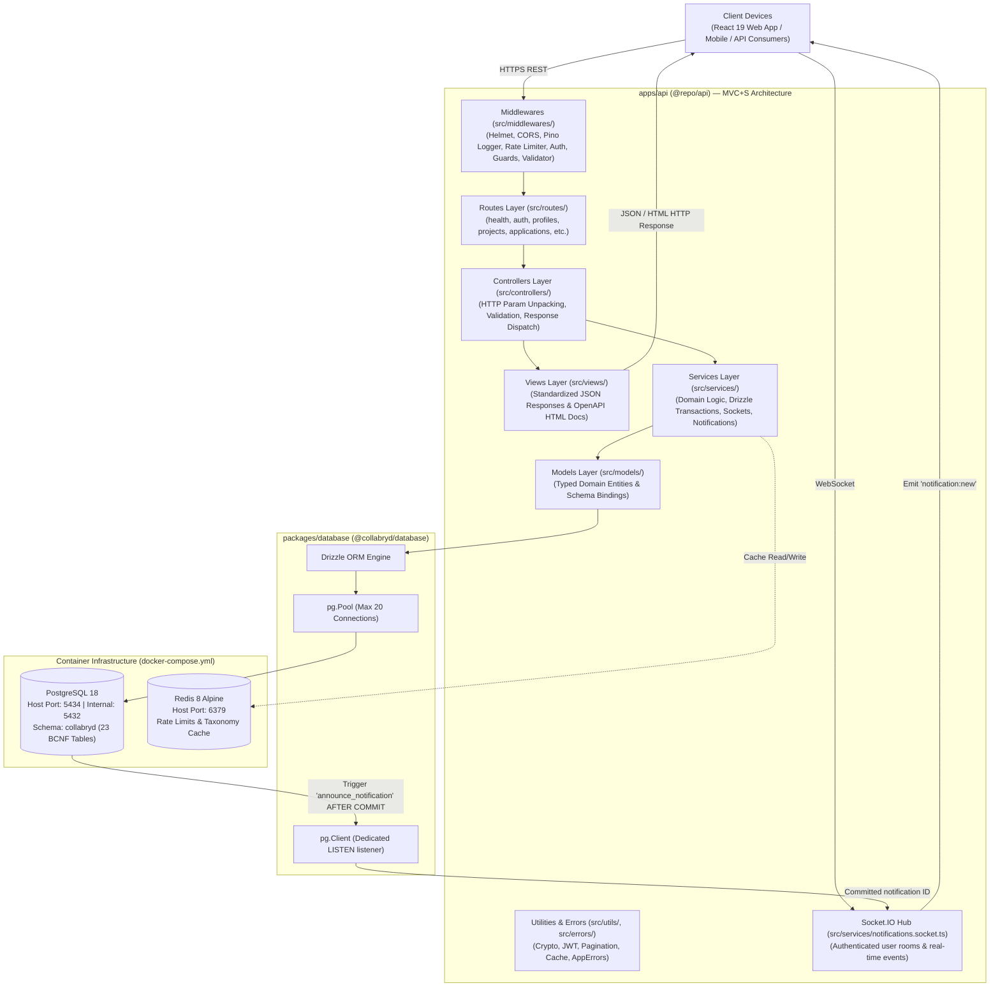
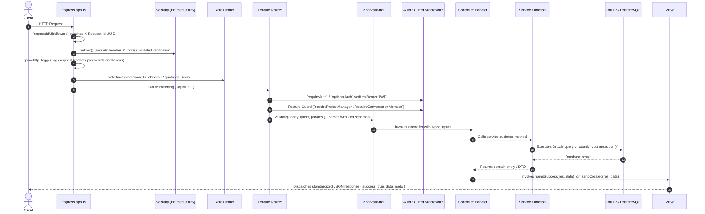
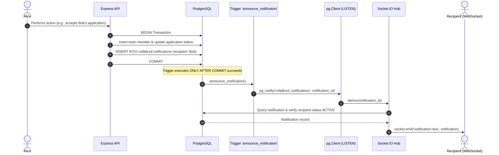

# Collabryd — Backend Architecture & Complete API Specification

This document provides a comprehensive, easy-to-understand reference for the entire **Collabryd backend architecture** (`apps/api` and `packages/database`). It maps out the system topology, middleware pipeline, database design, and **every single REST endpoint** with its underlying source files, functions, validation rules, transactional logic, and database interactions.

---

## Table of Contents

1. [High-Level Architecture & Tech Stack](#1-high-level-architecture--tech-stack)
2. [Request Lifecycle & Middleware Pipeline](#2-request-lifecycle--middleware-pipeline)
3. [Authentication, Sessions & Security Pipeline](#3-authentication-sessions--security-pipeline)
4. [Database & Persistence Architecture](#4-database--persistence-architecture)
5. [Real-Time Notifications & Socket Pipeline](#5-real-time-notifications--socket-pipeline)
6. [Complete Endpoint Catalog by Module](#6-complete-endpoint-catalog-by-module)
   - [6.1 System Health & Documentation](#61-system-health--documentation)
   - [6.2 Authentication & Identity (`/api/v1/auth`)](#62-authentication--identity-apiv1auth)
   - [6.3 Taxonomy Catalog (`/api/v1/catalog`)](#63-taxonomy-catalog-apiv1catalog)
   - [6.4 Student Profiles & Discovery (`/api/v1/profiles` & `/api/v1/students`)](#64-student-profiles--discovery-apiv1profiles--apiv1students)
   - [6.5 Projects & Recommendations (`/api/v1/projects` & `/api/v1/recommendations`)](#65-projects--recommendations-apiv1projects--apiv1recommendations)
   - [6.6 Project Applications (`/api/v1/applications`)](#66-project-applications-apiv1applications)
   - [6.7 Project Members & Team Rosters (`/api/v1/projects/:projectId/members`)](#67-project-members--team-rosters-apiv1projectsprojectidmembers)
   - [6.8 Conversations & Messaging (`/api/v1/conversations`)](#68-conversations--messaging-apiv1conversations)
   - [6.9 In-App Notifications (`/api/v1/notifications`)](#69-in-app-notifications-apiv1notifications)
   - [6.10 Campus Administration & Moderation (`/api/v1/admin`)](#610-campus-administration--moderation-apiv1admin)
7. [Testing & Operational Commands](#7-testing--operational-commands)

---

## 1. High-Level Architecture & Tech Stack

Collabryd uses a classic **Model-View-Controller architecture with Services (MVC+S)** backend built on Node.js and Express 5, encapsulated within the Turborepo monorepo.



### MVC Layer Responsibilities

| Layer | Directory | Primary Role & Responsibilities |
|---|---|---|
| **Models** | [`apps/api/src/models/`](file:///Users/shreyansh/Documents/Coding/ap/capstone/apps/api/src/models) | Re-exports and binds database schema entities, relations, and TypeScript types from `@collabryd/database`. Ensures domain entities are strongly typed throughout the API. |
| **Views** | [`apps/api/src/views/`](file:///Users/shreyansh/Documents/Coding/ap/capstone/apps/api/src/views) | Standardizes outbound responses (`response.view.ts` for uniform `{ success: true, data, meta }` envelopes, `docs.view.ts` for server-side HTML OpenAPI rendering). Decouples presentation formatting from business handlers. |
| **Controllers** | [`apps/api/src/controllers/`](file:///Users/shreyansh/Documents/Coding/ap/capstone/apps/api/src/controllers) | Thin HTTP request coordinators. Extracts validated query parameters, URL path parameters, and request body payloads; verifies session claims (`req.user`); invokes corresponding service methods; and delivers outputs to the view layer. Contains zero business or database logic. |
| **Services** | [`apps/api/src/services/`](file:///Users/shreyansh/Documents/Coding/ap/capstone/apps/api/src/services) | Heart of the application domain. Implements business logic, multi-table transactions via `db.transaction()`, capacity constraints, password hashing, JWT generation, event dispatching, and notification socket delivery. |
| **Routes** | [`apps/api/src/routes/`](file:///Users/shreyansh/Documents/Coding/ap/capstone/apps/api/src/routes) | Maps REST HTTP methods (`GET`, `POST`, `PUT`, `PATCH`, `DELETE`) to URI endpoints. Binds authentication, validation, and authorization middleware pipelines before delegating to controllers. Mounted centrally under `/api/v1` via `v1.routes.ts`. |
| **Middlewares** | [`apps/api/src/middlewares/`](file:///Users/shreyansh/Documents/Coding/ap/capstone/apps/api/src/middlewares) | Cross-cutting request filters: `auth.middleware.ts`, `validate.middleware.ts`, `error.middleware.ts`, `rate-limit.middleware.ts`, `request-id.middleware.ts`, `project-guard.middleware.ts`, `conversation-guard.middleware.ts`. |
| **Schemas** | [`apps/api/src/schemas/`](file:///Users/shreyansh/Documents/Coding/ap/capstone/apps/api/src/schemas) | Strict Zod validation contracts defining acceptable types, min/max lengths, email formats, and pagination limits for incoming request inputs. |
| **Utils** | [`apps/api/src/utils/`](file:///Users/shreyansh/Documents/Coding/ap/capstone/apps/api/src/utils) | Reusable stateless helper functions: cryptographic primitives (`crypto.ts`), JWT signing/verification (`jwt.ts`), pagination math (`pagination.ts`), multi-campus visibility checks (`visibility.ts`), and Redis caching (`cache.ts`). |
| **Errors** | [`apps/api/src/errors/`](file:///Users/shreyansh/Documents/Coding/ap/capstone/apps/api/src/errors) | Semantic domain error classes extending `AppError` (`NotFoundError`, `UnauthorizedError`, `ForbiddenError`, `ValidationError`, `ConflictError`, `DatabaseError`). |
| **Types** | [`apps/api/src/types/`](file:///Users/shreyansh/Documents/Coding/ap/capstone/apps/api/src/types) | Ambient TypeScript definitions and Express interface declarations (`express.d.ts`). |

### Key Technical Choices
- **Runtime:** Node.js `>= 24.0.0` (Native ECMAScript Modules).
- **Framework:** Express 5.2.1 ([`apps/api/src/app.ts`](file:///Users/shreyansh/Documents/Coding/ap/capstone/apps/api/src/app.ts)).
- **Primary Database:** PostgreSQL 18 mapped to host port **`5434`** ([`docker-compose.yml`](file:///Users/shreyansh/Documents/Coding/ap/capstone/docker-compose.yml#L12-L13)).
- **ORM:** Drizzle ORM 0.45.x ([`packages/database/src/client.ts`](file:///Users/shreyansh/Documents/Coding/ap/capstone/packages/database/src/client.ts#L28-L30)).
- **Caching & Rate Limiting:** Redis 8 Alpine (host port **`6379`**) with graceful fallback to local memory ([`apps/api/src/config/redis.ts`](file:///Users/shreyansh/Documents/Coding/ap/capstone/apps/api/src/config/redis.ts)).
- **Real-Time Push:** Socket.IO 4.8.x listening to PostgreSQL `LISTEN/NOTIFY` channels ([`apps/api/src/services/notifications.socket.ts`](file:///Users/shreyansh/Documents/Coding/ap/capstone/apps/api/src/services/notifications.socket.ts#L14)).

---

## 2. Request Lifecycle & Middleware Pipeline

Every HTTP request enters [`apps/api/src/app.ts`](file:///Users/shreyansh/Documents/Coding/ap/capstone/apps/api/src/app.ts#L22-L48) and moves through an ordered chain of middleware:



### Core Middlewares:
1. **`requestIdMiddleware`** ([`apps/api/src/middlewares/request-id.middleware.ts`](file:///Users/shreyansh/Documents/Coding/ap/capstone/apps/api/src/middlewares/request-id.middleware.ts#L7)): Attaches or preserves an `X-Request-Id` UUID header for request tracing.
2. **`authRateLimiter`** ([`apps/api/src/middlewares/rate-limit.middleware.ts`](file:///Users/shreyansh/Documents/Coding/ap/capstone/apps/api/src/middlewares/rate-limit.middleware.ts#L15-L25)): Limits auth attempts (max 10 requests per 15 minutes) using Redis or memory fallback.
3. **`validate`** ([`apps/api/src/middlewares/validate.middleware.ts`](file:///Users/shreyansh/Documents/Coding/ap/capstone/apps/api/src/middlewares/validate.middleware.ts#L18-L49)): Validates `req.body`, `req.query`, and `req.params` against Zod schemas. On failure, throws a `ValidationError` (HTTP 422).
4. **`requireAuth` & `optionalAuth`** ([`apps/api/src/middlewares/auth.middleware.ts`](file:///Users/shreyansh/Documents/Coding/ap/capstone/apps/api/src/middlewares/auth.middleware.ts#L33-L73)): Decodes and verifies the HMAC-SHA256 Bearer JWT. Checks that the user account is `ACTIVE`.
5. **`requireAdmin`** ([`apps/api/src/middlewares/auth.middleware.ts`](file:///Users/shreyansh/Documents/Coding/ap/capstone/apps/api/src/middlewares/auth.middleware.ts#L75-L81)): Asserts `req.user.systemRole === "ADMIN"`. Throws `ForbiddenError` (HTTP 403) otherwise.
6. **`errorHandler`** ([`apps/api/src/middlewares/error.middleware.ts`](file:///Users/shreyansh/Documents/Coding/ap/capstone/apps/api/src/middlewares/error.middleware.ts#L22-L79)): Central error handler that translates `AppError` subclasses and maps PostgreSQL error codes (`23505` $\to$ 409, `23503` $\to$ 404/400).

---

## 3. Authentication, Sessions & Security Pipeline

Collabryd enforces bank-grade security primitives:

```mermaid
flowchart TD
    subgraph Registration ["1. Student Registration"]
        A[Client Submit] --> B[assertAllowedEmailDomain]
        B --> C[Argon2id Hash Password]
        C --> D[Generate 32-byte CSPRNG Token]
        D --> E[Save User PENDING_VERIFICATION & Token Hash in DB]
        E --> F[Send Verification Email]
    end

    subgraph Login ["2. Login & Session Issuance"]
        G[Client Submit Email & Password] --> H[Verify Argon2id Hash]
        H --> I{Account Status ACTIVE?}
        I -->|No| J[Throw 403 EMAIL_NOT_VERIFIED or ACCOUNT_SUSPENDED]
        I -->|Yes| K[Sign Access Token - 15 min]
        K --> L[Sign Refresh Token - 7 days]
        L --> M[Insert record in refresh_sessions with Token Hash]
    end

    subgraph Rotation ["3. Rotating Refresh & Reuse Detection"]
        N[Client sends Refresh Token] --> O[Verify Refresh JWT & Find Session in DB]
        O --> P{Session already revoked?}
        P -->|YES: Replay Attack Detected| Q[Revoke ALL active user sessions across all devices]
        P -->|NO: Legitimate| R[Mark current session revoked & issue new Access + Refresh tokens]
    end
```



- **Password Hashing:** Implemented with `argon2.hash()` ([`apps/api/src/utils/crypto.ts`](file:///Users/shreyansh/Documents/Coding/ap/capstone/apps/api/src/utils/crypto.ts#L10-L15)) using Argon2id.
- **JWT Signatures:** Access tokens (15m) and refresh tokens (7d) signed with distinct secrets (`JWT_ACCESS_SECRET`, `JWT_REFRESH_SECRET`) ([`apps/api/src/utils/jwt.ts`](file:///Users/shreyansh/Documents/Coding/ap/capstone/apps/api/src/utils/jwt.ts#L42-L73)).
- **Session Reuse Detection:** In [`apps/api/src/services/auth.service.ts`](file:///Users/shreyansh/Documents/Coding/ap/capstone/apps/api/src/services/auth.service.ts#L353-L364), if an already-revoked refresh token is presented, the system detects a token leak and instantly invalidates every active session for that user.

---

## 4. Database & Persistence Architecture

The persistence layer lives in [`packages/database`](file:///Users/shreyansh/Documents/Coding/ap/capstone/packages/database). It defines **23 BCNF-normalized tables** in the `collabryd` schema.

| Domain Schema File | Tables Defined | Purpose |
|---|---|---|
| [`auth.ts`](file:///Users/shreyansh/Documents/Coding/ap/capstone/packages/database/src/schema/auth.ts) | `users`, `email_verification_tokens`, `refresh_sessions` | User credentials, email verification tokens, and rotating refresh sessions. |
| [`profiles.ts`](file:///Users/shreyansh/Documents/Coding/ap/capstone/packages/database/src/schema/profiles.ts) | `user_profiles`, `achievements`, `social_links` | Academic background, bios, visibility settings, honors, and external links. |
| [`catalog.ts`](file:///Users/shreyansh/Documents/Coding/ap/capstone/packages/database/src/schema/catalog.ts) | `skills`, `interests`, `roles`, `user_skills`, `user_interests`, `user_preferred_roles` | Standardized taxonomies and bridge tables associating students with skills. |
| [`projects.ts`](file:///Users/shreyansh/Documents/Coding/ap/capstone/packages/database/src/schema/projects.ts) | `projects`, `project_skills`, `project_roles`, `project_members`, `applications` | Project listings, required skills, open roles, team membership, and applications. |
| [`messaging.ts`](file:///Users/shreyansh/Documents/Coding/ap/capstone/packages/database/src/schema/messaging.ts) | `conversations`, `conversation_members`, `messages` | Direct/Group conversation channels, membership rosters, and sequenced messages. |
| [`notifications.ts`](file:///Users/shreyansh/Documents/Coding/ap/capstone/packages/database/src/schema/notifications.ts) | `notifications`, `notification_preferences` | In-app alerts, read states, and delivery preferences. |
| [`admin.ts`](file:///Users/shreyansh/Documents/Coding/ap/capstone/packages/database/src/schema/admin.ts) | `admin_audit_logs` | Immutable audit trail of administrative moderation actions. |

---

## 5. Real-Time Notifications & Socket Pipeline

Collabryd implements an **asynchronous committed-state event notification pipeline** in [`apps/api/src/services/notifications.socket.ts`](file:///Users/shreyansh/Documents/Coding/ap/capstone/apps/api/src/services/notifications.socket.ts#L14-L89):



- **Zero "Ghost" Notifications:** Because `pg_notify` fires `AFTER INSERT` upon transaction commit, failed or rolled-back operations never trigger socket emissions.
- **Socket Authentication:** Authenticates during the Socket.IO handshake via `verifyAccessToken(socket.handshake.auth.token)` and places sockets in personal rooms: `user:<userId>`.

---

## 6. Complete Endpoint Catalog by Domain (MVC Architecture)

Each subsection below outlines the **exact route**, **middleware chain**, **source code citations**, **validation rules**, and **step-by-step backend business logic**.

---

### 6.1 System Health & Documentation

#### `GET /api/health`
- **Purpose:** Quick liveness probe.
- **Auth:** None (Public).
- **Source Files:** [`apps/api/src/routes/health.routes.ts:8-18`](file:///Users/shreyansh/Documents/Coding/ap/capstone/apps/api/src/routes/health.routes.ts#L8-L18).
- **Logic:** Returns uptime in seconds and system timestamp without touching the database.

#### `GET /api/health/ready`
- **Purpose:** Readiness probe checking database and Redis connectivity.
- **Auth:** None (Public).
- **Source Files:** [`apps/api/src/routes/health.routes.ts:20-33`](file:///Users/shreyansh/Documents/Coding/ap/capstone/apps/api/src/routes/health.routes.ts#L20-L33).
- **Logic:**
  1. Executes `SELECT 1` via Drizzle to test PostgreSQL pool responsiveness.
  2. Calls `getRedisHealth()` ([`apps/api/src/config/redis.ts:63`](file:///Users/shreyansh/Documents/Coding/ap/capstone/apps/api/src/config/redis.ts#L63)) returning `"connected"`, `"disabled"`, or `"error"`.
  3. Returns HTTP 200 with `{ status: "ready", database: "connected", redis: ... }`.

#### `GET /api/v1/docs` & `GET /api/v1/docs/openapi.json`
- **Purpose:** Interactive HTML API explorer and raw OpenAPI 3.1 contract.
- **Auth:** None (Public).
- **Source Files:** [`apps/api/src/routes/v1.routes.ts:62-67`](file:///Users/shreyansh/Documents/Coding/ap/capstone/apps/api/src/routes/v1.routes.ts#L62-L67), [`apps/api/src/docs/openapi.ts`](file:///Users/shreyansh/Documents/Coding/ap/capstone/apps/api/src/docs/openapi.ts).
- **Logic:** Generates and serves OpenAPI specification describing endpoints, schemas, tags, and parameters.

---

### 6.2 Authentication & Identity (`/api/v1/auth`)

Mounted from [`apps/api/src/routes/auth.routes.ts`](file:///Users/shreyansh/Documents/Coding/ap/capstone/apps/api/src/routes/auth.routes.ts#L18-L60).

#### `POST /api/v1/auth/register`
- **Summary:** Register a new student account and issue a 6-digit OTP verification code.
- **Middleware:** `authRateLimiter`, `validate({ body: registerSchema })`.
- **Citations:**
  - Route: [`auth.routes.ts:18-23`](file:///Users/shreyansh/Documents/Coding/ap/capstone/apps/api/src/routes/auth.routes.ts#L18-L23)
  - Controller: [`auth.controller.ts:10-13`](file:///Users/shreyansh/Documents/Coding/ap/capstone/apps/api/src/controllers/auth.controller.ts#L10-L13)
  - Service: `registerStudent` in [`auth.service.ts`](file:///Users/shreyansh/Documents/Coding/ap/capstone/apps/api/src/services/auth.service.ts)
- **Validation:** Email, password (min 8 chars, 1 uppercase, 1 lowercase, 1 number), `displayName`, `institution`, `courseProgram`, `academicYear`.
- **Step-by-Step Logic:**
  1. Normalizes email and verifies it against allowed campus domains (`assertAllowedEmailDomain`).
  2. Queries `collabryd.users` to ensure email is not already taken; throws `ConflictError` (409) if duplicate.
  3. Hashes password using Argon2id.
  4. Generates a 6-digit numeric OTP via `generateNumericOtp(6)` and computes its SHA-256 hash.
  5. Executes atomic `db.transaction()`:
     - Inserts record into `collabryd.users` with status `PENDING_VERIFICATION` and role `STUDENT`.
     - Inserts profile into `collabryd.user_profiles`.
     - Initializes default `collabryd.notification_preferences`.
     - Stores hashed OTP in `collabryd.auth_otps` with `purpose = 'SIGNUP'`, `attempts = 0`, `maxAttempts = 5`, and 10-minute expiry.
     - Also stores token in `collabryd.email_verification_tokens` for backwards compatibility.
  6. Dispatches verification email via `sendOtpEmail` ([`verification-email.ts`](file:///Users/shreyansh/Documents/Coding/ap/capstone/apps/api/src/services/verification-email.ts)).

#### `POST /api/v1/auth/verify-otp`
- **Summary:** Verify 6-digit OTP for account activation or OTP-based login with retry limits.
- **Middleware:** `authRateLimiter`, `validate({ body: verifyOtpSchema })`.
- **Citations:** [`auth.routes.ts`](file:///Users/shreyansh/Documents/Coding/ap/capstone/apps/api/src/routes/auth.routes.ts), [`auth.controller.ts`](file:///Users/shreyansh/Documents/Coding/ap/capstone/apps/api/src/controllers/auth.controller.ts), [`auth.service.ts`](file:///Users/shreyansh/Documents/Coding/ap/capstone/apps/api/src/services/auth.service.ts).
- **Step-by-Step Logic:**
  1. Hashes incoming 6-digit OTP using SHA-256.
  2. Acquires advisory lock on normalized email and selects latest active OTP record with row lock (`FOR UPDATE`).
  3. Validates expiry (`expiresAt > Date.now()`) and attempts limit (`attempts < maxAttempts`).
  4. If hash does not match, increments `attempts` and returns remaining attempts count (or locks OTP after 5 failed attempts).
  5. If valid, marks OTP as used (`isUsed = true`) and activates user account if `PENDING_VERIFICATION`.
  6. If `purpose === 'LOGIN'`, issues access and rotating refresh tokens.

#### `POST /api/v1/auth/send-otp`
- **Summary:** Request a new 6-digit OTP for signup verification or passwordless login.
- **Middleware:** `authRateLimiter`, `validate({ body: sendOtpSchema })`.
- **Citations:** [`auth.routes.ts`](file:///Users/shreyansh/Documents/Coding/ap/capstone/apps/api/src/routes/auth.routes.ts), [`auth.controller.ts`](file:///Users/shreyansh/Documents/Coding/ap/capstone/apps/api/src/controllers/auth.controller.ts), [`auth.service.ts`](file:///Users/shreyansh/Documents/Coding/ap/capstone/apps/api/src/services/auth.service.ts).
- **Logic:** Acquires advisory lock, invalidates previous pending OTPs, generates a fresh 6-digit OTP, stores it in `collabryd.auth_otps` with a 10-minute TTL, and sends the code to the student's email.

#### `POST /api/v1/auth/login-otp`
- **Summary:** Authenticate student directly using a 6-digit login OTP and receive JWT tokens.
- **Middleware:** `authRateLimiter`, `validate({ body: loginWithOtpSchema })`.
- **Citations:** [`auth.routes.ts`](file:///Users/shreyansh/Documents/Coding/ap/capstone/apps/api/src/routes/auth.routes.ts), [`auth.controller.ts`](file:///Users/shreyansh/Documents/Coding/ap/capstone/apps/api/src/controllers/auth.controller.ts), [`auth.service.ts`](file:///Users/shreyansh/Documents/Coding/ap/capstone/apps/api/src/services/auth.service.ts).
- **Logic:** Calls `verifyOtp` with `purpose = 'LOGIN'`, verifies the 6-digit code, issues an access token and rotating refresh token, and creates a session record in `refresh_sessions`.

#### `POST /api/v1/auth/verify-email`
- **Summary:** Activate student account using email OTP or verification token.
- **Middleware:** `authRateLimiter`, `validate({ body: verifyEmailSchema })`.
- **Citations:** [`auth.routes.ts`](file:///Users/shreyansh/Documents/Coding/ap/capstone/apps/api/src/routes/auth.routes.ts), [`auth.controller.ts`](file:///Users/shreyansh/Documents/Coding/ap/capstone/apps/api/src/controllers/auth.controller.ts), [`auth.service.ts`](file:///Users/shreyansh/Documents/Coding/ap/capstone/apps/api/src/services/auth.service.ts).
- **Step-by-Step Logic:**
  1. Accepts either `{ otp }` or `{ token }` or `{ email, otp }`.
  2. Queries `auth_otps` or `email_verification_tokens`.
  3. Validates expiration and single-use state.
  4. Marks code as used and transitions user account from `PENDING_VERIFICATION` to `ACTIVE`.

#### `POST /api/v1/auth/resend-verification`
- **Summary:** Invalidate prior unused codes and issue a fresh 6-digit OTP verification code.
- **Middleware:** `authRateLimiter`, `validate({ body: resendVerificationSchema })`.
- **Citations:** [`auth.routes.ts`](file:///Users/shreyansh/Documents/Coding/ap/capstone/apps/api/src/routes/auth.routes.ts), [`auth.service.ts`](file:///Users/shreyansh/Documents/Coding/ap/capstone/apps/api/src/services/auth.service.ts).
- **Logic:** Acquires transaction-level advisory lock `pg_advisory_xact_lock` to serialize resend requests. Marks existing unused OTPs as used, generates a new 6-digit code, and triggers email delivery.

#### `POST /api/v1/auth/login`
- **Summary:** Authenticate student and issue JWT token pair.
- **Middleware:** `authRateLimiter`, `validate({ body: loginSchema })`.
- **Citations:** [`auth.routes.ts:36-41`](file:///Users/shreyansh/Documents/Coding/ap/capstone/apps/api/src/routes/auth.routes.ts#L36-L41), [`auth.service.ts:229-318`](file:///Users/shreyansh/Documents/Coding/ap/capstone/apps/api/src/services/auth.service.ts#L229-L318).
- **Step-by-Step Logic:**
  1. Finds user by lowercase email. Throws `UnauthorizedError` (401) if not found.
  2. Compares password against stored Argon2id hash.
  3. Verifies account status: throws 403 if `PENDING_VERIFICATION`, `SUSPENDED`, or `DEACTIVATED`.
  4. Generates access JWT (15m expiry) and refresh JWT with random `jti` (7d expiry).
  5. Inserts SHA-256 hash of refresh token into `collabryd.refresh_sessions`. Returns user profile & tokens.

#### `POST /api/v1/auth/refresh`
- **Summary:** Rotate refresh token and obtain a fresh access token.
- **Middleware:** `authRateLimiter`, `validate({ body: refreshSchema })`.
- **Citations:** [`auth.routes.ts:42-47`](file:///Users/shreyansh/Documents/Coding/ap/capstone/apps/api/src/routes/auth.routes.ts#L42-L47), [`auth.service.ts:320-410`](file:///Users/shreyansh/Documents/Coding/ap/capstone/apps/api/src/services/auth.service.ts#L320-L410).
- **Step-by-Step Logic:**
  1. Decodes and verifies incoming refresh JWT.
  2. Computes SHA-256 hash and locks session record (`FOR UPDATE`).
  3. **Reuse Detection:** If `session.revokedAt !== null`, triggers security tripwire: invalidates **all** active refresh sessions for this user and commits revocation, throwing 401 `REFRESH_TOKEN_REUSE_DETECTED`.
  4. If valid, marks current session `revokedAt = NOW()`, signs new token pair, and inserts a new session row.

#### `POST /api/v1/auth/logout` & `POST /api/v1/auth/logout-all`
- **Summary:** Revoke current session (`/logout`) or all user sessions (`/logout-all`).
- **Citations:** [`auth.routes.ts:48-53`](file:///Users/shreyansh/Documents/Coding/ap/capstone/apps/api/src/routes/auth.routes.ts#L48-L53), [`auth.service.ts:412-438`](file:///Users/shreyansh/Documents/Coding/ap/capstone/apps/api/src/services/auth.service.ts#L412-L438).
- **Logic:** Sets `revokedAt = NOW()` on the matching session or across all active sessions belonging to `req.user.userId`.

#### `GET /api/v1/auth/me`
- **Summary:** Get current authenticated user credentials and profile.
- **Middleware:** `requireAuth`.
- **Citations:** [`auth.routes.ts:54`](file:///Users/shreyansh/Documents/Coding/ap/capstone/apps/api/src/routes/auth.routes.ts#L54), [`auth.service.ts:440-471`](file:///Users/shreyansh/Documents/Coding/ap/capstone/apps/api/src/services/auth.service.ts#L440-L471).

#### `PATCH /api/v1/auth/password`
- **Summary:** Change account password and revoke existing sessions.
- **Middleware:** `requireAuth`, `validate({ body: changePasswordSchema })`.
- **Citations:** [`auth.routes.ts:55-60`](file:///Users/shreyansh/Documents/Coding/ap/capstone/apps/api/src/routes/auth.routes.ts#L55-L60), [`auth.service.ts:473-513`](file:///Users/shreyansh/Documents/Coding/ap/capstone/apps/api/src/services/auth.service.ts#L473-L513).
- **Logic:** Verifies current password with Argon2id, hashes new password, updates `passwordHash`, and revokes all active refresh sessions to force re-authentication.

---

### 6.3 Taxonomy Catalog (`/api/v1/catalog`)

Mounted from [`apps/api/src/routes/catalog.routes.ts`](file:///Users/shreyansh/Documents/Coding/ap/capstone/apps/api/src/routes/catalog.routes.ts#L17-L57).

#### `GET /api/v1/catalog/skills`
- **Summary:** List skills with student usage count (R07 query).
- **Middleware:** `validate({ query: listSkillsQuerySchema })`.
- **Citations:** [`catalog.routes.ts:19-23`](file:///Users/shreyansh/Documents/Coding/ap/capstone/apps/api/src/routes/catalog.routes.ts#L19-L23), [`catalog.service.ts:20-64`](file:///Users/shreyansh/Documents/Coding/ap/capstone/apps/api/src/services/catalog.service.ts#L20-L64).
- **Logic:** Cached in Redis (TTL 60s). Queries `collabryd.skills` left-joined with `collabryd.user_skills`, groups by skill, and orders by student adoption count descending.

#### `POST /api/v1/catalog/skills`
- **Summary:** Create a new skill taxonomy entry (Admin only).
- **Middleware:** `requireAuth`, `requireAdmin`, `validate({ body: createSkillSchema })`.
- **Citations:** [`catalog.routes.ts:24-30`](file:///Users/shreyansh/Documents/Coding/ap/capstone/apps/api/src/routes/catalog.routes.ts#L24-L30), [`catalog.service.ts:160-164`](file:///Users/shreyansh/Documents/Coding/ap/capstone/apps/api/src/services/catalog.service.ts#L160-L164).
- **Logic:** Inserts into `collabryd.skills` and invalidates Redis cache keys matching prefix `catalog:skills:`.

#### `GET /api/v1/catalog/interests` & `POST /api/v1/catalog/interests`
- **Summary:** Search interest domains with follower counts (R08) / Add new interest.
- **Citations:** [`catalog.routes.ts:32-43`](file:///Users/shreyansh/Documents/Coding/ap/capstone/apps/api/src/routes/catalog.routes.ts#L32-L43), [`catalog.service.ts:66-114, 166-170`](file:///Users/shreyansh/Documents/Coding/ap/capstone/apps/api/src/services/catalog.service.ts#L66-L114).

#### `GET /api/v1/catalog/roles` & `POST /api/v1/catalog/roles`
- **Summary:** List project roles with open openings count (R09) / Add new role.
- **Citations:** [`catalog.routes.ts:45-56`](file:///Users/shreyansh/Documents/Coding/ap/capstone/apps/api/src/routes/catalog.routes.ts#L45-L56), [`catalog.service.ts:116-158, 172-182`](file:///Users/shreyansh/Documents/Coding/ap/capstone/apps/api/src/services/catalog.service.ts#L116-L158).

---

### 6.4 Student Profiles & Discovery (`/api/v1/profiles` & `/api/v1/students`)

Mounted from [`apps/api/src/routes/profiles.routes.ts`](file:///Users/shreyansh/Documents/Coding/ap/capstone/apps/api/src/routes/profiles.routes.ts#L24-L108).

#### `GET /api/v1/profiles/me`
- **Summary:** Fetch the full profile of the logged-in student including skills, interests, roles, achievements, and social links (R02–R05).
- **Middleware:** `requireAuth`.
- **Citations:** [`profiles.routes.ts:28`](file:///Users/shreyansh/Documents/Coding/ap/capstone/apps/api/src/routes/profiles.routes.ts#L28), [`profiles.service.ts:96-128`](file:///Users/shreyansh/Documents/Coding/ap/capstone/apps/api/src/services/profiles.service.ts#L96-L128).
- **Logic:** Performs parallel queries gathering profile details, associated skills (with proficiency levels), interests, preferred roles, achievements, and social links.

#### `PUT /api/v1/profiles/me`
- **Summary:** Upsert student profile fields (bio, major, year, availability, visibility).
- **Middleware:** `requireAuth`, `validate({ body: upsertProfileSchema })`.
- **Citations:** [`profiles.routes.ts:29-33`](file:///Users/shreyansh/Documents/Coding/ap/capstone/apps/api/src/routes/profiles.routes.ts#L29-L33), [`profiles.service.ts:314-368`](file:///Users/shreyansh/Documents/Coding/ap/capstone/apps/api/src/services/profiles.service.ts#L314-L368).
- **Logic:** Uses PostgreSQL `INSERT INTO user_profiles ... ON CONFLICT (user_id) DO UPDATE` to atomically update profile information.

#### `POST /api/v1/profiles/me/skills`, `PUT /api/v1/profiles/me/skills`, `DELETE /api/v1/profiles/me/skills/:skillId`
- **Summary:** Add, bulk replace, or remove skills on student profile.
- **Citations:** [`profiles.routes.ts:35-49`](file:///Users/shreyansh/Documents/Coding/ap/capstone/apps/api/src/routes/profiles.routes.ts#L35-L49), [`profiles.service.ts:370-473`](file:///Users/shreyansh/Documents/Coding/ap/capstone/apps/api/src/services/profiles.service.ts#L370-L473).
- **Logic:** Bulk replacement runs inside `db.transaction()`: deletes existing user skills and inserts new entries in a single step.

#### `PUT /api/v1/profiles/me/interests` & `PUT /api/v1/profiles/me/preferred-roles`
- **Summary:** Replace student interests and preferred project roles in bulk.
- **Citations:** [`profiles.routes.ts:51-61`](file:///Users/shreyansh/Documents/Coding/ap/capstone/apps/api/src/routes/profiles.routes.ts#L51-L61), [`profiles.service.ts:475-523`](file:///Users/shreyansh/Documents/Coding/ap/capstone/apps/api/src/services/profiles.service.ts#L475-L523).

#### `POST /api/v1/profiles/me/achievements`, `PATCH .../:achievementId`, `DELETE .../:achievementId`
- **Summary:** Manage student awards, certifications, and hackathon wins.
- **Citations:** [`profiles.routes.ts:63-77`](file:///Users/shreyansh/Documents/Coding/ap/capstone/apps/api/src/routes/profiles.routes.ts#L63-L77), [`profiles.service.ts:525-591`](file:///Users/shreyansh/Documents/Coding/ap/capstone/apps/api/src/services/profiles.service.ts#L525-L591).

#### `POST /api/v1/profiles/me/social-links`, `PATCH .../:linkId`, `DELETE .../:linkId`
- **Summary:** Add, update, or delete external links (GitHub, LinkedIn, Portfolio).
- **Citations:** [`profiles.routes.ts:79-93`](file:///Users/shreyansh/Documents/Coding/ap/capstone/apps/api/src/routes/profiles.routes.ts#L79-L93), [`profiles.service.ts:593-633`](file:///Users/shreyansh/Documents/Coding/ap/capstone/apps/api/src/services/profiles.service.ts#L593-L633).

#### `GET /api/v1/students`
- **Summary:** Discover peers across campus by skill, role, academic year, and availability.
- **Middleware:** `optionalAuth`, `validate({ query: discoverStudentsQuerySchema })`.
- **Citations:** [`profiles.routes.ts:98-102`](file:///Users/shreyansh/Documents/Coding/ap/capstone/apps/api/src/routes/profiles.routes.ts#L98-L102), [`profiles.service.ts:184-312`](file:///Users/shreyansh/Documents/Coding/ap/capstone/apps/api/src/services/profiles.service.ts#L184-L312).
- **Visibility Filtering:** Enforces `PUBLIC` for anonymous viewers, `CAMPUS_ONLY` for students matching institution, excludes `PRIVATE` profiles.

#### `GET /api/v1/students/:userId`
- **Summary:** View a specific student's public/campus profile (R06).
- **Middleware:** `optionalAuth`, `validate({ params: userIdParamsSchema })`.
- **Citations:** [`profiles.routes.ts:103-108`](file:///Users/shreyansh/Documents/Coding/ap/capstone/apps/api/src/routes/profiles.routes.ts#L103-L108), [`profiles.service.ts:130-182`](file:///Users/shreyansh/Documents/Coding/ap/capstone/apps/api/src/services/profiles.service.ts#L130-L182).

---

### 6.5 Projects & Recommendations (`/api/v1/projects` & `/api/v1/recommendations`)

Mounted from [`apps/api/src/routes/projects.routes.ts`](file:///Users/shreyansh/Documents/Coding/ap/capstone/apps/api/src/routes/projects.routes.ts#L23-L172).

#### `GET /api/v1/projects`
- **Summary:** Search and list projects by category, required skill, role, or text query (R10 & R11).
- **Middleware:** `optionalAuth`, `validate({ query: listProjectsQuerySchema })`.
- **Citations:** [`projects.routes.ts:28-33`](file:///Users/shreyansh/Documents/Coding/ap/capstone/apps/api/src/routes/projects.routes.ts#L28-L33), [`projects.service.ts:231-403`](file:///Users/shreyansh/Documents/Coding/ap/capstone/apps/api/src/services/projects.service.ts#L231-L403).

#### `POST /api/v1/projects`
- **Summary:** Create a project, assign owner, and initialize team chat.
- **Middleware:** `requireAuth`, `validate({ body: createProjectSchema })`.
- **Citations:** [`projects.routes.ts:38-43`](file:///Users/shreyansh/Documents/Coding/ap/capstone/apps/api/src/routes/projects.routes.ts#L38-L43), [`projects.service.ts:108-229`](file:///Users/shreyansh/Documents/Coding/ap/capstone/apps/api/src/services/projects.service.ts#L108-L229).
- **Atomic Creation Logic (`db.transaction`):**
  1. Inserts project row into `collabryd.projects`.
  2. Inserts creator as `OWNER` into `collabryd.project_members`.
  3. Inserts required skills (`project_skills`) and open roles (`project_roles`).
  4. Automatically creates a `GROUP` conversation in `collabryd.conversations` linked to `projectId`.
  5. Adds owner to `collabryd.conversation_members`.

#### `GET /api/v1/projects/:projectId`
- **Summary:** Retrieve comprehensive project details, required skills, and open roles (R12 & R14).
- **Citations:** [`projects.routes.ts:48-53`](file:///Users/shreyansh/Documents/Coding/ap/capstone/apps/api/src/routes/projects.routes.ts#L48-L53), [`projects.service.ts:405-506`](file:///Users/shreyansh/Documents/Coding/ap/capstone/apps/api/src/services/projects.service.ts#L405-L506).

#### `PATCH /api/v1/projects/:projectId` & `PATCH .../:projectId/status`
- **Summary:** Update project metadata or transition status (`DRAFT` $\to$ `OPEN` $\to$ `IN_PROGRESS` $\to$ `COMPLETED` $\to$ `CANCELLED`).
- **Middleware:** `requireAuth`, `requireProjectManager`.
- **Citations:** [`projects.routes.ts:58-75`](file:///Users/shreyansh/Documents/Coding/ap/capstone/apps/api/src/routes/projects.routes.ts#L58-L75), [`projects.service.ts:508-622`](file:///Users/shreyansh/Documents/Coding/ap/capstone/apps/api/src/services/projects.service.ts#L508-L622).
- **Status Change Logic:** Updates status and automatically dispatches notifications to all team members informing them of the status update.

#### `DELETE /api/v1/projects/:projectId`
- **Summary:** Delete project (Sole Owner or Admin required).
- **Middleware:** `requireAuth`, `requireProjectOwner`.
- **Citations:** [`projects.routes.ts:80-86`](file:///Users/shreyansh/Documents/Coding/ap/capstone/apps/api/src/routes/projects.routes.ts#L80-L86), [`projects.service.ts:624-646`](file:///Users/shreyansh/Documents/Coding/ap/capstone/apps/api/src/services/projects.service.ts#L624-L646).

#### `PUT /api/v1/projects/:projectId/skills`, `DELETE .../skills/:skillId`
- **Summary:** Bulk update or remove required skills for a project.
- **Citations:** [`projects.routes.ts:91-111`](file:///Users/shreyansh/Documents/Coding/ap/capstone/apps/api/src/routes/projects.routes.ts#L91-L111), [`projects.service.ts:648-716`](file:///Users/shreyansh/Documents/Coding/ap/capstone/apps/api/src/services/projects.service.ts#L648-L716).

#### `PUT /api/v1/projects/:projectId/roles`, `DELETE .../roles/:roleId`
- **Summary:** Bulk update or remove open recruitment roles.
- **Citations:** [`projects.routes.ts:116-136`](file:///Users/shreyansh/Documents/Coding/ap/capstone/apps/api/src/routes/projects.routes.ts#L116-L136), [`projects.service.ts:718-790`](file:///Users/shreyansh/Documents/Coding/ap/capstone/apps/api/src/services/projects.service.ts#L718-L790).

#### `GET /api/v1/projects/:projectId/capacity`
- **Summary:** Read current member count vs. `maxTeamSize` (R19).
- **Citations:** [`projects.routes.ts:141-146`](file:///Users/shreyansh/Documents/Coding/ap/capstone/apps/api/src/routes/projects.routes.ts#L141-L146), [`projects.service.ts:813-840`](file:///Users/shreyansh/Documents/Coding/ap/capstone/apps/api/src/services/projects.service.ts#L813-L840).

#### `GET /api/v1/projects/:projectId/recommendations`
- **Summary:** Recommend compatible student candidates for a project (R15).
- **Middleware:** `requireAuth`, `requireProjectManager`.
- **Citations:** [`projects.routes.ts:151-160`](file:///Users/shreyansh/Documents/Coding/ap/capstone/apps/api/src/routes/projects.routes.ts#L151-L160), [`projects.service.ts:842-893`](file:///Users/shreyansh/Documents/Coding/ap/capstone/apps/api/src/services/projects.service.ts#L842-L893).
- **Logic:** Compares candidate skills with the project's required skills; computes matching overlap scores and ranks candidates available for collaboration.

#### `GET /api/v1/recommendations/projects`
- **Summary:** Recommend projects for the logged-in student (R16).
- **Middleware:** `requireAuth`.
- **Citations:** [`projects.routes.ts:168-172`](file:///Users/shreyansh/Documents/Coding/ap/capstone/apps/api/src/routes/projects.routes.ts#L168-L172), [`projects.service.ts:895-950`](file:///Users/shreyansh/Documents/Coding/ap/capstone/apps/api/src/services/projects.service.ts#L895-L950).
- **Logic:** Matches student skills and preferred roles against open project vacancies; filters out already-joined projects.

---

### 6.6 Project Applications (`/api/v1/applications`)

Mounted from [`apps/api/src/routes/applications.routes.ts`](file:///Users/shreyansh/Documents/Coding/ap/capstone/apps/api/src/routes/applications.routes.ts#L15-L88).

#### `POST /api/v1/projects/:projectId/applications`
- **Summary:** Submit an application to join a project team (W07).
- **Middleware:** `requireAuth`, `validate({ body: createApplicationSchema })`.
- **Citations:** [`applications.routes.ts:20-25`](file:///Users/shreyansh/Documents/Coding/ap/capstone/apps/api/src/routes/applications.routes.ts#L20-L25), [`applications.service.ts:27-161`](file:///Users/shreyansh/Documents/Coding/ap/capstone/apps/api/src/services/applications.service.ts#L27-L161).
- **Step-by-Step Logic:**
  1. Checks project status is `OPEN` and application deadline has not passed.
  2. Verifies student is not already a team member.
  3. Checks partial unique index `uq_active_application` (cannot apply twice if an application is already `PENDING`).
  4. Inserts into `collabryd.applications`.
  5. Emits notification to the project owner.

#### `GET /api/v1/projects/:projectId/applications`
- **Summary:** List applications for a specific project (Project Manager required).
- **Citations:** [`applications.routes.ts:30-39`](file:///Users/shreyansh/Documents/Coding/ap/capstone/apps/api/src/routes/applications.routes.ts#L30-L39), [`applications.service.ts:163-210`](file:///Users/shreyansh/Documents/Coding/ap/capstone/apps/api/src/services/applications.service.ts#L163-L210).

#### `GET /api/v1/applications/me` & `GET /api/v1/applications/incoming`
- **Summary:** List my submitted applications (R18) / List incoming applications across all managed projects (R17).
- **Citations:** [`applications.routes.ts:48-61`](file:///Users/shreyansh/Documents/Coding/ap/capstone/apps/api/src/routes/applications.routes.ts#L48-L61), [`applications.service.ts:212-321`](file:///Users/shreyansh/Documents/Coding/ap/capstone/apps/api/src/services/applications.service.ts#L212-L321).

#### `POST /api/v1/applications/:applicationId/accept`
- **Summary:** Accept an applicant into the team and group chat (W08).
- **Middleware:** `requireAuth`.
- **Citations:** [`applications.routes.ts:66-70`](file:///Users/shreyansh/Documents/Coding/ap/capstone/apps/api/src/routes/applications.routes.ts#L66-L70), [`applications.service.ts:323-486`](file:///Users/shreyansh/Documents/Coding/ap/capstone/apps/api/src/services/applications.service.ts#L323-L486).
- **Transactional Capacity Locking (`db.transaction`):**
  1. Selects project row `FOR UPDATE` to lock concurrency.
  2. Counts active `project_members`. If `count >= maxTeamSize`, throws `ConflictError` ("Project has reached capacity").
  3. Updates application status to `ACCEPTED`.
  4. Inserts applicant into `collabryd.project_members`.
  5. Inserts applicant into `collabryd.conversation_members` for the project group chat.
  6. Dispatches notification to accepted applicant.

#### `POST /api/v1/applications/:applicationId/reject` & `POST .../withdraw`
- **Summary:** Reject application / Withdraw submitted application.
- **Citations:** [`applications.routes.ts:75-87`](file:///Users/shreyansh/Documents/Coding/ap/capstone/apps/api/src/routes/applications.routes.ts#L75-L87), [`applications.service.ts:488-614`](file:///Users/shreyansh/Documents/Coding/ap/capstone/apps/api/src/services/applications.service.ts#L488-L614).

---

### 6.7 Project Members & Team Rosters (`/api/v1/projects/:projectId/members`)

Mounted from [`apps/api/src/routes/members.routes.ts`](file:///Users/shreyansh/Documents/Coding/ap/capstone/apps/api/src/routes/members.routes.ts#L15-L48).

#### `GET /api/v1/projects/:projectId/members`
- **Summary:** List team roster ordered by role hierarchy (`OWNER` $\to$ `ADMIN` $\to$ `MEMBER`) (R13).
- **Citations:** [`members.routes.ts:20-25`](file:///Users/shreyansh/Documents/Coding/ap/capstone/apps/api/src/routes/members.routes.ts#L20-L25), [`members.service.ts:20-45`](file:///Users/shreyansh/Documents/Coding/ap/capstone/apps/api/src/services/members.service.ts#L20-L45).

#### `PATCH /api/v1/projects/:projectId/members/:userId`
- **Summary:** Promote/demote a member or transfer project ownership.
- **Middleware:** `requireAuth`, `requireProjectManager`, `validate({ body: updateMemberRoleSchema })`.
- **Citations:** [`members.routes.ts:30-36`](file:///Users/shreyansh/Documents/Coding/ap/capstone/apps/api/src/routes/members.routes.ts#L30-L36), [`members.service.ts:47-125`](file:///Users/shreyansh/Documents/Coding/ap/capstone/apps/api/src/services/members.service.ts#L47-L125).
- **Ownership Transfer Logic:** If promoting someone to `OWNER`, the transaction atomically demotes the current owner to `ADMIN` and updates `projects.ownerId`.

#### `DELETE /api/v1/projects/:projectId/members/:userId`
- **Summary:** Remove member or leave project team.
- **Middleware:** `requireAuth`.
- **Citations:** [`members.routes.ts:41-46`](file:///Users/shreyansh/Documents/Coding/ap/capstone/apps/api/src/routes/members.routes.ts#L41-L46), [`members.service.ts:127-232`](file:///Users/shreyansh/Documents/Coding/ap/capstone/apps/api/src/services/members.service.ts#L127-L232).
- **Logic:** Prevents the sole owner from leaving without transferring ownership. Removes the member from `project_members` and simultaneously removes them from the project group conversation (`conversation_members`).

---

### 6.8 Conversations & Messaging (`/api/v1/conversations`)

Mounted from [`apps/api/src/routes/conversations.routes.ts`](file:///Users/shreyansh/Documents/Coding/ap/capstone/apps/api/src/routes/conversations.routes.ts#L20-L86).

#### `GET /api/v1/conversations`
- **Summary:** List all conversations (DMs & Project Chats) for the caller with last message and unread count (R20).
- **Citations:** [`conversations.routes.ts:25`](file:///Users/shreyansh/Documents/Coding/ap/capstone/apps/api/src/routes/conversations.routes.ts#L25), [`conversations.service.ts:20-90`](file:///Users/shreyansh/Documents/Coding/ap/capstone/apps/api/src/services/conversations.service.ts#L20-L90).

#### `POST /api/v1/conversations/direct`
- **Summary:** Create or retrieve an existing 1-on-1 direct message channel (R21).
- **Citations:** [`conversations.routes.ts:30-34`](file:///Users/shreyansh/Documents/Coding/ap/capstone/apps/api/src/routes/conversations.routes.ts#L30-L34), [`conversations.service.ts:92-160`](file:///Users/shreyansh/Documents/Coding/ap/capstone/apps/api/src/services/conversations.service.ts#L92-L160).
- **Advisory Lock Deduplication:** Executes `SELECT pg_advisory_xact_lock(hashtext(least(u1, u2)), hashtext(greatest(u1, u2)))`. Guarantees concurrent requests between two users resolve to the same channel without duplicate conversation rows.

#### `GET /api/v1/conversations/project/:projectId`
- **Summary:** Retrieve the group conversation corresponding to a project team.
- **Citations:** [`conversations.routes.ts:39-43`](file:///Users/shreyansh/Documents/Coding/ap/capstone/apps/api/src/routes/conversations.routes.ts#L39-L43), [`conversations.service.ts:162-236`](file:///Users/shreyansh/Documents/Coding/ap/capstone/apps/api/src/services/conversations.service.ts#L162-L236).

#### `GET /api/v1/conversations/:conversationId/messages`
- **Summary:** Keyset/cursor-based message pagination (R22).
- **Middleware:** `requireConversationMember`.
- **Citations:** [`conversations.routes.ts:49-57`](file:///Users/shreyansh/Documents/Coding/ap/capstone/apps/api/src/routes/conversations.routes.ts#L49-L57), [`conversations.service.ts:238-309`](file:///Users/shreyansh/Documents/Coding/ap/capstone/apps/api/src/services/conversations.service.ts#L238-L309).
- **Logic:** Paginates messages based on `beforeSequenceNumber` or `afterSequenceNumber` using index on `(conversation_id, sequence_number)`.

#### `POST /api/v1/conversations/:conversationId/messages`
- **Summary:** Post an immutable, sequenced message (W09).
- **Middleware:** `requireConversationMember`, `validate({ body: sendMessageSchema })`.
- **Citations:** [`conversations.routes.ts:63-71`](file:///Users/shreyansh/Documents/Coding/ap/capstone/apps/api/src/routes/conversations.routes.ts#L63-L71), [`conversations.service.ts:311-444`](file:///Users/shreyansh/Documents/Coding/ap/capstone/apps/api/src/services/conversations.service.ts#L311-L444).
- **Sequencing & Idempotency:**
  1. Checks `clientMessageId` to prevent duplicate message posting on network retries.
  2. Locks conversation row `FOR UPDATE` to compute monotonic `sequence_number = max(sequence_number) + 1`.
  3. Inserts message and updates conversation `last_message_at`.
  4. Triggers in-app notifications to other conversation participants.

#### `PATCH /api/v1/conversations/:conversationId/read`
- **Summary:** Advance user's read cursor to mark messages as read.
- **Citations:** [`conversations.routes.ts:77-85`](file:///Users/shreyansh/Documents/Coding/ap/capstone/apps/api/src/routes/conversations.routes.ts#L77-L85), [`conversations.service.ts:446-476`](file:///Users/shreyansh/Documents/Coding/ap/capstone/apps/api/src/services/conversations.service.ts#L446-L476).

---

### 6.9 In-App Notifications (`/api/v1/notifications`)

Mounted from [`apps/api/src/routes/notifications.routes.ts`](file:///Users/shreyansh/Documents/Coding/ap/capstone/apps/api/src/routes/notifications.routes.ts#L13-L39).

#### `GET /api/v1/notifications`
- **Summary:** Paginate in-app notification inbox (R23).
- **Citations:** [`notifications.routes.ts:15-19`](file:///Users/shreyansh/Documents/Coding/ap/capstone/apps/api/src/routes/notifications.routes.ts#L15-L19), [`notifications.service.ts:6-35`](file:///Users/shreyansh/Documents/Coding/ap/capstone/apps/api/src/services/notifications.service.ts#L6-L35).

#### `GET /api/v1/notifications/unread-count`
- **Summary:** Fetch total unread notifications count for badge UI.
- **Citations:** [`notifications.routes.ts:21`](file:///Users/shreyansh/Documents/Coding/ap/capstone/apps/api/src/routes/notifications.routes.ts#L21), [`notifications.service.ts:37-48`](file:///Users/shreyansh/Documents/Coding/ap/capstone/apps/api/src/services/notifications.service.ts#L37-L48).

#### `PATCH /api/v1/notifications/read-all` & `PATCH .../:notificationId/read`
- **Summary:** Mark all or single notification as read (W10).
- **Citations:** [`notifications.routes.ts:23, 33-37`](file:///Users/shreyansh/Documents/Coding/ap/capstone/apps/api/src/routes/notifications.routes.ts#L23), [`notifications.service.ts:50-85`](file:///Users/shreyansh/Documents/Coding/ap/capstone/apps/api/src/services/notifications.service.ts#L50-L85).

#### `GET /api/v1/notifications/preferences` & `PATCH .../preferences`
- **Summary:** View or update notification channels (in-app, email).
- **Citations:** [`notifications.routes.ts:25-31`](file:///Users/shreyansh/Documents/Coding/ap/capstone/apps/api/src/routes/notifications.routes.ts#L25-L31), [`notifications.service.ts:87-137`](file:///Users/shreyansh/Documents/Coding/ap/capstone/apps/api/src/services/notifications.service.ts#L87-L137).

---

### 6.10 Campus Administration & Moderation (`/api/v1/admin`)

Mounted from [`apps/api/src/routes/admin.routes.ts`](file:///Users/shreyansh/Documents/Coding/ap/capstone/apps/api/src/routes/admin.routes.ts#L20-L54). All endpoints require `requireAuth` and `requireAdmin`.

#### `GET /api/v1/admin/metrics`
- **Summary:** Operational platform KPIs (R24).
- **Citations:** [`admin.routes.ts:22`](file:///Users/shreyansh/Documents/Coding/ap/capstone/apps/api/src/routes/admin.routes.ts#L22), [`admin.service.ts:21-48`](file:///Users/shreyansh/Documents/Coding/ap/capstone/apps/api/src/services/admin.service.ts#L21-L48).
- **Logic:** Queries aggregate counts of registered students, active projects, submitted applications, and completed teams.

#### `GET /api/v1/admin/audit-logs`
- **Summary:** Paginated administrative audit log trail (R25).
- **Citations:** [`admin.routes.ts:24-28`](file:///Users/shreyansh/Documents/Coding/ap/capstone/apps/api/src/routes/admin.routes.ts#L24-L28), [`admin.service.ts:50-94`](file:///Users/shreyansh/Documents/Coding/ap/capstone/apps/api/src/services/admin.service.ts#L50-L94).

#### `POST /api/v1/admin/users/:userId/suspend`
- **Summary:** Suspend a malicious student account.
- **Citations:** [`admin.routes.ts:30-34`](file:///Users/shreyansh/Documents/Coding/ap/capstone/apps/api/src/routes/admin.routes.ts#L30-L34), [`admin.service.ts:96-151`](file:///Users/shreyansh/Documents/Coding/ap/capstone/apps/api/src/services/admin.service.ts#L96-L151).
- **Step-by-Step Logic:**
  1. Sets `users.accountStatus = 'SUSPENDED'`.
  2. Revokes all active refresh sessions (`refresh_sessions.revokedAt = NOW()`).
  3. Writes audit entry to `collabryd.admin_audit_logs`.

#### `POST /api/v1/admin/users/:userId/activate`
- **Summary:** Restore a suspended student account.
- **Citations:** [`admin.routes.ts:36-40`](file:///Users/shreyansh/Documents/Coding/ap/capstone/apps/api/src/routes/admin.routes.ts#L36-L40), [`admin.service.ts:153-193`](file:///Users/shreyansh/Documents/Coding/ap/capstone/apps/api/src/services/admin.service.ts#L153-L193).

#### `POST /api/v1/admin/projects/:projectId/moderate`
- **Summary:** Change project status for moderation purposes (e.g. archiving infringing projects).
- **Citations:** [`admin.routes.ts:42-46`](file:///Users/shreyansh/Documents/Coding/ap/capstone/apps/api/src/routes/admin.routes.ts#L42-L46), [`admin.service.ts:195-245`](file:///Users/shreyansh/Documents/Coding/ap/capstone/apps/api/src/services/admin.service.ts#L195-L245).

#### `POST /api/v1/admin/projects/:projectId/members/:userId/role-override`
- **Summary:** Forcefully assign or reassign a project member's role.
- **Citations:** [`admin.routes.ts:48-52`](file:///Users/shreyansh/Documents/Coding/ap/capstone/apps/api/src/routes/admin.routes.ts#L48-L52), [`admin.service.ts:247-296`](file:///Users/shreyansh/Documents/Coding/ap/capstone/apps/api/src/services/admin.service.ts#L247-L296).

---

## 7. Testing & Operational Commands

All commands are executed from the repository root:

```bash
# 1. Launch local PostgreSQL (port 5434) and Redis (port 6379)
docker compose up -d

# 2. Apply all database migrations
pnpm db:migrate

# 3. Seed demo accounts & taxonomies
pnpm db:seed

# 4. Start backend development server (port 3000)
pnpm backend:dev

# 5. Type-check all packages
pnpm check-types

# 6. Run unit tests
pnpm --filter @repo/api test

# 7. Run full E2E integration test suite (requires Docker Postgres)
pnpm test
```
